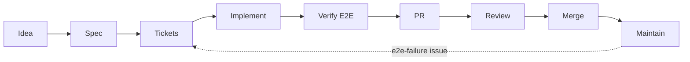

# Skills playbook

This guide covers three agent skill stacks: what each skill does, which one to reach for at each stage of Wander-Fit's workflow, and what to change before we adopt them. It holds the catalog, the overlap decisions, the stage map, and a proposal for changing tstack. It changes no app code and installs nothing.

Read [`GLOSSARY.md`](../../GLOSSARY.md), the [ADRs](../adr/) and [`e2e-testing-plan.md`](../e2e-testing-plan.md) §9 first. This guide uses their words: *athlete*, *flow*, *persona*, the three *brakes*.

## Sources read

Every claim below comes from the primary sources at these commits, read on 2026-10-27:

| Stack | Repo | Commit | What was read |
|---|---|---|---|
| **tstack** (Theo, t3dotgg) | [t3dotgg/tstack](https://github.com/t3dotgg/tstack) | [`7de017b`](https://github.com/t3dotgg/tstack/commit/7de017b3fc9d50c03cf3ecb98fb71e0ca65a78bd) (2026-10-24) | README, all 9 `SKILL.md`, `agents/openai.yaml`, the `pr-wait` header |
| **Matt Pocock's skills** | [mattpocock/skills](https://github.com/mattpocock/skills) | [`5beb35b`](https://github.com/mattpocock/skills/commit/5beb35b040e3de97e54fa9e386d7e42d15c295c2) (2026-10-19), plugin v1.3.1 | README, `CLAUDE.md`, `SCOPE.md`, `.agents/invocation.md`, ADRs, `.out-of-scope/harness-name-collisions.md`, bucket READMEs, all 27 shipped `SKILL.md` |
| `/software-factory` (in progress) | [mattpocock/skills#1316](https://github.com/mattpocock/skills/pull/1316) | [`b59cab4`](https://github.com/mattpocock/skills/commit/b59cab42bf1206e1363eafc37f71b21c3bcaa12f) (2026-10-22) | `SKILL.md`, `EXAMPLE-TASKS.md` |
| **pstack** (poteto, Lauren Tan) | [cursor/plugins](https://github.com/cursor/plugins/tree/main/pstack) | [`ab69380`](https://github.com/cursor/plugins/commit/ab69380dd50ee47d426b35cb8369cffdddafc218) (2026-10-26), plugin v0.15.32 | The Claude Code copy in `harness/pstack/claude-code/`: README, the Claude Code adapter, all 10 guide pages, all 58 `SKILL.md`, both agents, 11 of the 23 `poteto-mode` playbooks |

Not read in full: Matt's `misc/` skills and his `in-progress/` skills other than `software-factory` (neither ships in the plugin), and pstack's reference files under `why/`, `interrogate/` and `reflect/`, plus its remaining 12 playbooks.

### How each stack installs

- **Matt** is already installed as `mattpocock-skills@claude-plugins-official`. It updates itself.
- **pstack** installs with `/plugin marketplace add cursor/plugins`, then `/plugin install pstack@cursor-plugins`. The marketplace entry points at `harness/pstack/claude-code/`: a generated copy of the Cursor skills, plus one line per skill telling the agent to read [`docs/harness/claude-code.md`](https://github.com/cursor/plugins/blob/main/harness/pstack/claude-code/docs/harness/claude-code.md). That adapter maps Cursor names to Claude Code names. Auto-update is off for third-party marketplaces.
- **tstack** is not a plugin. You copy the folders into `~/.claude/skills/` and `~/.codex/skills/`. It needs an authenticated `gh` and `python3`, and some skills use T3 Code tools when they are available.

## Two ideas to hold first

**Who can fire a skill.** A *user-only* skill runs only when you type it (`disable-model-invocation: true`). A *model-invoked* skill can also be picked up by the agent when the task matches its description. The stacks differ sharply here:

- **Matt** splits his skills on purpose. User-only skills orchestrate a flow. Model-invoked skills hold reusable discipline (`tdd`, `grilling`, `code-review`, `pr`) that other skills call.
- **pstack** in Claude Code is user-only except for `setup-pstack`. Its skills reach each other by reading files: `/pstack:poteto-mode` reads the other `SKILL.md` files directly, because the adapter says "The `Skill` tool refuses most pstack skills". So the agent never wanders into pstack by itself. You enter through `/pstack:poteto-mode` or a named skill.
- **tstack** sets no invocation flag, so every skill is model-invoked. Most descriptions only fire on a phrase ("Trigger this if the user says 'full send'"). `file-pr`, `babysit-pr`, `takeover`, `modernize` and `leaving-pr-comments` fire on ordinary words.

**Namespacing.** Claude Code puts plugin skills behind the plugin's name: `/mattpocock-skills:tdd`, `/pstack:tdd`. Skills copied into `~/.claude/skills/` or `.claude/skills/` have no prefix (`/council`). Matt's repo records the practice in [`harness-name-collisions.md`](https://github.com/mattpocock/skills/blob/main/.out-of-scope/harness-name-collisions.md): it won't rename skills to dodge collisions, so type the namespaced form. Run `/skills` after installing anything to see what each bare name resolves to.

## Catalog

**Invocation:** **U** means user-only (you type it). **M** means model-invoked (you or the agent). Stack: **T** is tstack, **M** is Matt, **P** is pstack. Command names are shown as you would type them in Claude Code.

### tstack (9 skills)

| Skill | What it does | When to use | In → Out | Inv. |
|---|---|---|---|---|
| `full-send` | Takes a change to a merged PR with nobody watching: prove, `sol-loop`, `file-pr`, `babysit-pr`, merge. | You walk away and grant merge authority. | Request → merged PR, proof, decision list | M (phrase) |
| `full-stop` | `full-send` but stops at a merge-ready PR. Never merges or arms auto-merge. | You walk away and want to merge it yourself. | Request → ready PR, verdict, proof | M (phrase) |
| `council` | Three delegates on three providers review in rounds until all are satisfied. Scores go in the PR body. | A contested change that's worth cross-provider review. | Diff → findings, a score table | M (phrase) |
| `sol-loop` | GPT Sol reviews the change for at most 3 rounds (5 for security or data), with a severity ledger. | A pre-PR correctness pass on a different model. | Diff → ledger, verdict | M (phrase) |
| `file-pr` | Files a short PR. The title says why it matters, the body leads with the problem, and it ends with a model and harness line. | Every PR. | Branch → PR | M |
| `babysit-pr` | Watches CI and review bots with one watcher (`pr-wait` or T3 `watch_pull_request`), fixes real findings, declines scope creep. | After a PR opens. | PR → ready or blocked PR | M |
| `takeover` | Finishes someone else's PR, branch or thread, and keeps their git credit. | Picking up a stale or abandoned PR. | Source PR → continuation PR | M |
| `modernize` | Rebases an old PR and recommends MODERNIZE, REWORK or CLOSE. | Old PRs that need a decision (#56). | PR → disposition, rebased branch | M |
| `leaving-pr-comments` | Starts every agent comment with a `> [!NOTE] 🤖 <model> responding on behalf of <user>` callout. | Whenever an agent comments on GitHub. | Draft → formatted comment | M |

### Matt Pocock (27 shipped skills, plus 1 in progress)

| Skill | What it does | When to use | In → Out | Inv. |
|---|---|---|---|---|
| `ask-matt` | A router over Matt's flows. | You're unsure which Matt skill fits. | Situation → route | U |
| `setup-matt-pocock-skills` | Writes `docs/agents/*` and the `## Agent skills` block. | Once per repo (done). | Repo → config files | U |
| `grill-me` | Runs `grilling` with no paper trail. | Thinking with no repo under it. | Idea → shared understanding | U |
| `grill-with-docs` | Runs `grilling` and `domain-modeling`. | Every new idea in this repo. | Idea → decisions, `GLOSSARY.md`, ADRs | U |
| `grilling` | Rounds of numbered questions with a recommended answer for each. Facts are the agent's job; decisions are yours. | Underneath the skills above, or directly. | Plan → resolved design tree | M |
| `domain-modeling` | Challenges terms and updates `GLOSSARY.md` and ADRs inline. | When the words are the problem. | Terms → glossary, ADR | M |
| `to-spec` | Synthesizes the conversation into a spec issue (no interview) and names the test seams. | After grilling, for multi-session work. | Thread → spec issue (`ready-for-agent`) | U |
| `to-tickets` | Splits a spec into tracer-bullet tickets with blocking edges. | After `to-spec`. | Spec → linked issues | U |
| `implement` | Builds one ticket with `tdd` at agreed seams, then `code-review`, then commits. | Each ticket, with a fresh context per ticket. | Ticket → commits | U |
| `implement-spec` | Builds a whole spec on one integration branch with parallel implementer subagents. | You want to orchestrate the build. | Spec + tickets → integration branch | U |
| `wayfinder` | A map issue of decision tickets for work too big for one session. | A foggy, multi-session effort. | Loose idea → map, decisions | U |
| `triage` | Moves incoming issues through `needs-triage` → `ready-for-*` and writes agent briefs. | Issues you didn't write, such as `e2e-failure` reports. | Issue → labelled issue, brief | U |
| `improve-codebase-architecture` | An HTML report of "deepening" candidates, then grills you on the one you pick. | Upkeep, every few days. | Hot spots → report, an idea | U |
| `retro` | Suggests changes to the agent's *environment* (checks, standards, steering files) after a session. | After a build, especially one that went sideways. | Session → ranked suggestions | U |
| `handoff` | Writes a handoff doc to the OS temp folder. | Moving to a new harness, folder or person. | Thread → handoff file | U |
| `teach` | A multi-session learning workspace: mission, HTML lessons, quizzes, learning records. | Learning a topic over weeks. | Topic → `lessons/`, `reference/` | U |
| `to-questionnaire` | Writes a questionnaire for someone who holds knowledge you lack. | A decision that needs your co-founder or a coach. | Gap → Markdown questionnaire | U |
| `wait-what` | Re-pitches the last message in plain words. | A reply didn't land. | Last reply → re-pitch | U |
| `prototype` | Throwaway code that answers one design question: a logic HTML file or switchable UI variants. | A question you can't settle on paper. | Question → prototype branch, verdict | M |
| `diagnosing-bugs` | A red-capable feedback loop first, then minimise, hypothesise, instrument, fix, regression test. | Hard or intermittent bugs. | Bug → fix, regression test | M |
| `research` | A background agent reads primary sources and writes a cited Markdown file. | Reading legwork. | Question → cited notes file | M |
| `tdd` | Red → green, one vertical slice at a time, only at seams you confirmed. | Building behavior test-first. | Seams → tests and code | M |
| `codebase-design` | Deep-module vocabulary: module, interface, seam, depth. | Shaping a module's interface. | Design → shared terms | M |
| `code-review` | Two parallel sub-reviews of a diff: **Standards** (repo docs and Fowler smells) and **Spec** (the originating issue). | Closing out a ticket or a PR. | Diff + spec → two reports | M |
| `pr` | The PR body: **Summary** visual, **Evidence** before/after, **Merge Danger** (door and blast radius). | Writing any PR body. | Change → PR body | M |
| `wizard` | Generates an interactive bash script for steps only a human can do. | Plan §11: Convex project, Clerk, secrets. | Procedure → `scripts/*.sh` | M |
| `writing-for-agents` | How to write skills and `AGENTS.md`. | Editing agent-facing docs. | Doc → tighter doc | M |
| `software-factory` *(PR #1316, not in the plugin)* | The vocabulary for designing a factory: task, trigger, run, runner, the three brakes, "start slow". | Designing plan §9. | Problem → slots and tasks | U |

### pstack (58 skills: 34 workflow skills and 24 principles)

All are user-only in Claude Code except `setup-pstack`. Type them as `/pstack:<name>`.

| Skill | What it does | When to use | In → Out |
|---|---|---|---|
| `poteto-mode` | Matches the task to one of 23 playbooks (Bug fix, Feature, Refactoring, Babysit, Shipping, Autonomous run…), copies its steps into a todo list, and runs other skills as needed. | Any non-trivial task that needs rigor. | Goal + done check → playbook run, cited reply |
| `poteto-help` | Answers "which skill?" and hands you a prompt. Doesn't start work. | Unsure in pstack. | Question → prompt |
| `setup-pstack` | Writes `~/.claude/rules/pstack-models.md` (models per role) and offers the verification generators. **Model-invoked.** | Once per machine. | Budget → rule file |
| `how` | Explorers, then an explainer: how a subsystem works now. | Before changing code you don't know. | Question → architecture explainer |
| `why` | Parallel investigators over git and every MCP evidence source; a cited rationale with confidence levels. | Why code has its shape. | Target → cited history |
| `teach` | Runs `how` and `why` and explains plainly, diagram by diagram. No quizzes. | Understanding a change or subsystem. | Code → explanation |
| `recall` | Rebuilds your context from your own transcripts and the shared record. | Resuming a topic after days away. | Topic → brief |
| `ketchup` / `ketchup-video` | What changed in this chat since your last message, plus every decision waiting on you. | Coming back to a long run. | Chat → catch-up |
| `in-your-own-words` / `bro` / `sharpen` | Restate the goal; restate the last reply plainly; deepen a prompt before sending it. | Prompt hygiene. | Text → text |
| `architect` | Sketches types and signatures through `arena` (two or more designs), then implements against the sketch. | Code that crosses a function boundary. | Problem → sketch, then code |
| `arena` | N candidates on one brief, a cross-judge, pick a base, graft the best parts of the rest. | A design or code bake-off. | Brief → synthesized artifact |
| `swarm` | N workers across slices or races, one report. | Coverage, such as verifying each flow. | Slices → PASS/ISSUES table |
| `interrogate` | Reviewers on different model families attack a diff; the lead sorts findings into Act on, Consider, Noted, Dismissed. | A contested diff before shipping. | Diff → verdict |
| `blast-radius` | Finds breakage beyond the diff and proves the one fact the change's safety rests on. | A small diff you don't trust. | Diff → risks, proof |
| `tdd` | A failing test first, *for bug fixes with a cheap local test path only*. | A cheap regression test exists. | Bug → red/green evidence |
| `no-comments` | The Comment Sicko agent deletes comments and flags workarounds as `MUST KILL`. | Before review. | Diff → fewer comments |
| `unslop` / `technical-writing` | A catalog of AI writing tells, and a layered writing standard. | Prose and PR bodies. | Text → text |
| `typescript-best-practices` | TypeScript rules: unions, brands, no `as`. | `.ts`/`.tsx` work. | Code → rules |
| `figure-it-out` | Designs a custom, auditable playbook for big or unattended work. | No playbook fits, or you're stepping away. | Task → phases, decision log |
| `show-me-your-work` | An append-only TSV decision log with a cross-model audit. | Long or unattended runs. | Run → `decisions.tsv` |
| `create-verification-skill` | Generates `.claude/skills/verify-<app>/` (Launch, Doctor, Drive, Evidence, Cleanup, a `features/` map) and proves it once end to end. | Once the Maestro framework lands (plan §9). | Repo → verify skill |
| `maintain-verification-skill` | A source pass per feature plus one live pass. The outcome is clean, changed (at most one PR) or blocked. | Nightly. | Verify skill → corrections PR |
| `create-` / `maintain-formal-verification-skill` | Model-checks or proves one property (TLA+ by default) and generates a recheck skill. | Races and state machines. Not needed yet. | Property → verify skill |
| `statechart` | A Mermaid statechart from a TLA+ model, with bugs drawn as numbered paths. | Showing behavior to a non-engineer. | Model → chart |
| `benchmark-checklist` | Seven questions before you trust a performance number. | Perf claims. | Number → verdict |
| `reflect` | Three reviewers mine the transcript and propose skill edits for you to approve. | After a long task. | Transcript → skill edits |
| `correct` | Makes a repeated agent mistake impossible: architecture, then types, then lint, then tests, then docs. | The same correction twice. | History → checks, rule table |
| `automate-me` | Mines your transcripts into a personal `<you>-mode` skill. | Once you have habits worth encoding. | History → mode skill |
| `make-bot-ui` | Builds a page that wakes a Cursor "Grok Bot" over a webhook. | Cursor only. Skip. | — |
| 24 `principle-*` skills | One rule each (Prove It Works, Laziness Protocol, Model the Domain…). `poteto-mode` cites them. | Steer by name: "apply prove it works". | — |

pstack also ships two subagents, `pstack:poteto-agent` (a delegate that reads `poteto-mode` first) and `pstack:comment-sicko`.

## Overlaps and decisions

Each row names the skill to prefer in **this** repo and why. Two founders, no users and a Maestro E2E plan make some choices easy.

| Area | Candidates | Prefer | Why |
|---|---|---|---|
| **TDD** | `mattpocock-skills:tdd`, `pstack:tdd` | **Matt's** | Matt's `tdd` is the feature loop. It tests only at seams agreed in advance, and `to-spec` already records seams under *Testing Decisions*. pstack's is narrower: a bug-fix regression test, skipped when the test path is expensive. `diagnosing-bugs` covers that case and is stricter. |
| **Teach** | `mattpocock-skills:teach`, `pstack:teach` | **Both, for different jobs** | Same name, different skill. Matt's runs a multi-session course (lessons, quizzes, learning records) for *learning a topic*. pstack's explains *this code* in one sitting. Learning the skill stacks: Matt's. Understanding `execute/[id].tsx`: pstack's. |
| **Code review** | `mattpocock-skills:code-review`, `pstack:interrogate`, tstack `council` / `sol-loop`, Claude Code's built-in `/code-review`, `anthropic-skills:rn-code-review` | **Matt's `code-review` inside `/implement`; the built-in `/code-review` for automated review** | Matt's checks *Standards* and *Spec* separately, and each ticket has a spec. The built-in is a bug hunter that can post inline PR comments, which suits plan §9 task 3. `interrogate`, `council` and `sol-loop` get their value from *different model families*. In Claude Code, non-Claude slots fall back to the session model, so the diversity disappears. Keep them for T3 Code or Codex sessions on contested changes. |
| **Grilling vs. architect** | `grilling` / `grill-with-docs`, `pstack:architect` | **Grilling before the spec; architect inside implementation** | They answer different questions. Grilling settles *what* (decisions are yours). `architect` settles the *shape of the code* (types and module boundaries) once the ticket exists. pstack's principle *Never Block on the Human* conflicts with grilling's "the decisions are yours". Resolve it by stage: product and design calls go to you, code-shape calls go to the agent. |
| **PR writing** | `mattpocock-skills:pr`, tstack `file-pr`, pstack Opening a PR playbook | **Matt's `pr` template for the body; tstack's `file-pr` steps around it** | Plan §6 already chose Matt's Summary / Evidence / Merge Danger, and Evidence is where Maestro videos go. `file-pr` adds useful steps: check for an existing PR, review the diff, title for why, scan for secrets. pstack's Conventional Commits title and ready-not-draft rule are a third convention we don't need. |
| **Verification** | `pstack:create-verification-skill` / `maintain-verification-skill`, tstack *Proof*, `diagnosing-bugs` Phase 1, the built-in `/run` | **pstack's generator, fed by the Maestro flows** | Already the plan (§1, §9). tstack's *Proof* rule ("green mocked tests do not prove the user experience works") is the same bar. Once `verify-wander-fit` exists, make it the proof method for `full-stop`. |
| **Babysitting PRs** | tstack `babysit-pr`, pstack Babysit playbook, the cloud session's built-in PR subscription | **In cloud sessions: the built-in subscription. Locally: tstack `babysit-pr`. In T3 Code: `watch_pull_request`.** | All three say "one watcher per PR, no sleep loops". Pick the one native to where you run. pstack's watcher pulls in its Shipping and stack-landing machinery, which is too much for two founders. |
| **Handoffs** | `mattpocock-skills:handoff`, tstack `takeover`, pstack Session pickup / Pause safely, T3 Code's portable handoffs | **`handoff` between harnesses; `takeover` for someone else's PR** | They differ by what moves: a conversation (`handoff`), a PR with credit (`takeover`), or an in-flight run (pstack). |
| **Retros** | `mattpocock-skills:retro`, `pstack:reflect`, `pstack:correct` | **`retro` after sessions; `correct` once a mistake repeats** | `retro` targets the environment; `reflect` targets pstack's own skills (we won't edit those); `correct` makes the fix structural. That matches ADR-0004's spirit: prefer a check over a rule. |
| **Routers** | `ask-matt`, `pstack:poteto-help` | **This document, then `ask-matt`** | Each router only knows its own stack. |

### Same names

| Name | Where | Resolve with |
|---|---|---|
| `tdd` | Matt, pstack | `/mattpocock-skills:tdd` vs `/pstack:tdd` |
| `teach` | Matt, pstack | `/mattpocock-skills:teach` vs `/pstack:teach` |
| `code-review` | Matt, Claude Code built-in | `/mattpocock-skills:code-review` vs `/code-review` |
| `prototype` | Matt skill, pstack playbook (not a skill) | `/mattpocock-skills:prototype`; pstack's runs only inside `poteto-mode` |
| babysit | tstack `babysit-pr`, pstack Babysit playbook, Cursor built-in | Different names in Claude Code, so no collision |

### Instructions that clash

1. **Where config lives.**
   - **Matt** writes `docs/agents/*.md` and an `## Agent skills` block in `CLAUDE.md`, or in `AGENTS.md` when there's no `CLAUDE.md`. Ours lives in `AGENTS.md`, which `CLAUDE.md` imports. Leave it there.
   - **pstack** writes `~/.claude/rules/pstack-models.md` on each machine and says never to put role lines in `CLAUDE.md` or `AGENTS.md`. Its verify skill goes in `.claude/skills/verify-wander-fit/`. Its decision logs go in `decisions.tsv` or `.audit/`, uncommitted by default.
   - **tstack** says to put personal settings, such as council members, in `CLAUDE.md` or `AGENTS.md`.

   **Decision:** repo conventions go in `docs/agents/`, with one pointer line in `AGENTS.md`. Personal model choices stay out of the repo: pstack's rule file, and council members in `~/.claude/CLAUDE.md`.
2. **Draft or ready PRs.** tstack's `file-pr` and pstack's Opening a PR both say "open a real PR, not a draft, so review bots run". Claude Code cloud sessions are told to open drafts. *Your call, below.*
3. **Attribution.** There are four formats:
   - tstack's `🤖 <model> responding on behalf of <user>` callout,
   - the cloud session's `Generated by Claude Code` footer,
   - Matt's triage line `> *This was generated by AI during triage.*`,
   - `file-pr`'s closing `Created with <model> in <harness>` line.

   Cloud sessions are also told never to put model IDs in PR bodies or commits, which conflicts with `file-pr`'s line. *Your call, below.*
4. **Merging and human review.** `full-send` merges on its own and overrides ask-first testing rules. Plan §9 puts human review on every PR. That conflicts with the third brake. **Decision:** don't use `full-send` here.
5. **Asking vs. proceeding.** pstack's *Never Block on the Human* and `poteto-mode`'s Autonomy section say to proceed on reversible work. `grilling`, and this repo's habit of asking before outward-facing actions, say to ask. **Decision:** follow the stage rule above. Outward-facing actions (posting, installing, opening issues) always ask.
6. **Test runner.** `AGENTS.md` still describes two runners (Jest and Vitest). ADR-0004 says Jest only, after plan step 0b. Matt's `code-review` reads `AGENTS.md` as a standard, so until 0b lands it will enforce the stale split. Rewrite that section in the 0b PR, as the plan already says.

## Stage map

What fires at each stage, for two founders with no users yet. **Bold** is the default; the rest are situational.

| Stage | Fires | Notes |
|---|---|---|
| **Idea** | **`/grill-with-docs`**. Also `/mattpocock-skills:prototype` or the pstack Prototype playbook when a question needs running code; `/research` for reading legwork; `/wayfinder` for foggy work bigger than one session; `/to-questionnaire` to pull an answer from your co-founder. | Keep idea → spec → tickets in one context window (`ask-matt`). |
| **Spec** | **`/to-spec`** | Its *Testing Decisions* section names the seam (unit, E2E or both), per plan §8. |
| **Tickets** | **`/to-tickets`** | Native sub-issues and blocking links, per `docs/agents/issue-tracker.md`. |
| **Implement** | **`/implement`** per ticket (runs `tdd` and `code-review`), or `/implement-spec`. Also `/pstack:architect` for boundary-crossing shape; `/pstack:how` before touching an unfamiliar screen; `/diagnosing-bugs` for bugs. | Clear context between tickets. |
| **Verify (E2E)** | **The Maestro flow for the journey**. Later, **`/verify-wander-fit`** (generated by `/pstack:create-verification-skill`). The built-in `/run` before both exist. | Plan §8: a new or changed journey ships its flow in the same PR. |
| **PR** | **`/mattpocock-skills:pr`** for the body, inside tstack **`full-stop`** (or `file-pr`) when you want it driven to merge-ready. | Evidence links the flow's video artifact. |
| **Review** | **Automated:** the Claude Code GitHub Action with `/code-review` (plan §9 task 3). **Human:** you. On demand: `/pstack:interrogate`, or tstack `council` in T3 Code for contested changes. | Brake 2 and brake 3. |
| **Babysit** | The cloud session's PR subscription, or tstack `babysit-pr` | One watcher per PR. |
| **Merge** | **A human.** | No skill merges here. |
| **Maintain** | **`/pstack:maintain-verification-skill`** nightly; **`/triage`** for `e2e-failure` issues; `/improve-codebase-architecture` every few days; `/retro` after rough sessions; `/pstack:correct` for repeat mistakes; tstack `modernize` for stale PRs such as #56. | |
| **Founder-only steps** (plan §11) | **`/wizard`** | Turns the Convex, Clerk and secrets checklist into one script. |

### Plan §9 factory tasks

Mapped onto `/software-factory`'s vocabulary. Each task is added one at a time, with human review on every PR.

| Task | Trigger | Skill in the run | Next |
|---|---|---|---|
| 1. Automated checks | PR, push to `main` | none (CI jobs) | Brake 1 |
| 2. E2E failure reporting | Nightly native run fails | none (`report` job). Then a human runs `/triage`, and `/diagnosing-bugs` reproduces it with the flow. | An `e2e-failure` issue |
| 3. Automated review | PR opens | Built-in `/code-review` in the Claude Code Action. Later, Matt's two-axis review when the PR links a spec. | Human review |
| 4. Ratchet | Daily clock, when a stricter check arrives | `/implement` on one exception-list file | Automated review |
| Later: verify-skill upkeep | Nightly Claude Code scheduled task | `/pstack:maintain-verification-skill` | At most one PR |
| Later: implementer | Issue labelled `ready-for-agent` | `/implement` inside tstack `full-stop` | Automated review, then human |

`/software-factory` itself is user-only and ships only in-progress (`npx skills@latest add mattpocock/skills --skill=software-factory`). Its *Question every task* checklist is how you finish the §9 design: trigger, reads and writes, what fires next, where a human re-enters, and what stops two runs doing the same work.

## Proposal: changes to tstack (awaiting approval)

Nothing below has been applied. Each item says what to change and why. Approve, reject or amend each one; the edits would land in a separate PR.

**Where it lives.** Install tstack as *project* skills in `.claude/skills/` (committed), not `~/.claude/skills/`, so cloud sessions and your co-founder get the same copy. The repo-specific edits below then travel with the code. Codex would need its own copy, which T3 Code's own repo keeps in `.agents/skills/`. Pin the upstream commit in a short `README` beside the skills so updates are a deliberate diff.

| # | Skill | Change | Why |
|---|---|---|---|
| T1 | `full-send` | Don't install it. | It merges unattended and overrides ask-first test rules, which conflicts with the human-review brake (plan §9, `/software-factory` "start slow"). |
| T2 | `full-stop` | Inline the parts of `full-send` it needs (it says "Read full-send"), and make Proof concrete. Before `verify-wander-fit` exists, Proof is `npm run test:ci`, `npm run test:unit`, `npm run typecheck` and the journey's Maestro web flow. After, it is `/verify-wander-fit`, with the video linked in Evidence. | `full-stop` depends on `full-send`'s text, and generic proof rules let "tests pass" through for UI work. |
| T3 | `file-pr` | Replace its description guidance with "use the `pr` skill's template (Summary, Evidence, Merge Danger)". Keep the existing-PR check, the diff review, the why-first title and the secrets scan. Change the closing model line per decision D2. | Plan §6 already chose Matt's template. One body format, not two. |
| T4 | `babysit-pr` | Default to `--until green`, since we have no Greptile or Macroscope. Add: "In a Claude Code cloud session, use the session's PR subscription instead of `pr-wait`." Name our required checks (`typecheck`, later `unit` and `e2e-web`). | `ready` waits for bots we don't run. Cloud sessions already get PR events pushed to them. |
| T5 | `council`, `sol-loop` | Add `disable-model-invocation: true`. Add a line saying they run only in T3 Code or Codex sessions that can reach the other providers' models. Keep council members out of the repo, in `~/.claude/CLAUDE.md`. | Claude Code subagents can't run GPT Sol or Gemini, and both skills say to report rather than substitute. In Claude Code they always end at "blocked". |
| T6 | `full-stop`, `takeover`, `modernize` | Add `disable-model-invocation: true`. | These act on branches and PRs. The plain words that trigger `takeover` ("take over") and `modernize` ("rebase a pr") show up in normal chat. They should run only when you type them. |
| T7 | `leaving-pr-comments` | Align it with decision D2: one attribution format across agents. | Today an agent could stack tstack's callout and the cloud session's footer on one comment. |
| T8 | all | Add one line pointing at `GLOSSARY.md` ("use its terms in titles, bodies and comments"). | Matt's skills already do this. tstack's don't, so PR titles drift to "user" and "client". |

**Matt, small edits:**

- **M1.** Rewrite `AGENTS.md`'s two-runner section in plan step 0b, as already planned, so `code-review`'s Standards axis stops enforcing it.
- **M2.** Add a `CODING_STANDARDS.md`, read only at review time, holding the judgment-call rules from `AGENTS.md`. `retro` recommends this, and `code-review` must read it if it exists.
- **M3.** Leave Matt's skills themselves unedited. The plugin updates itself, and `SCOPE.md` says personal tweaks belong in your own files.

**pstack, configuration only:**

- **P1.** Leave its skills unedited (it's a generated copy).
- **P2.** When you install it, run `/pstack:setup-pstack` and set the review panels (`interrogate reviewers`, `arena runners`, `architect runners`) to two different Claude models, such as `opus xhigh, sonnet high`. Otherwise the default Grok slot silently becomes a second copy of the session model.
- **P3.** Skip `make-bot-ui` and the formal-verification pair for now.

## Decisions waiting on you

- **D1. Draft or ready PRs** for agent-opened PRs. Recommendation: **ready**, once the Claude Code review Action exists (plan §9 task 3), so it runs. Draft until then.
- **D2. One attribution format.** Recommendation: the cloud footer on comments, tstack's callout dropped, and `Created in <harness>` with no model name at the end of PR bodies. That also satisfies the cloud rule against model IDs.
- **D3. Approve T1–T8 and M1–M2**, item by item.
- **D4. Install pstack now or after Phase 1?** Recommendation: **after Phase 1**, as plan §9 says. Its main payoff, `create-verification-skill`, needs the Maestro flows to exist.
